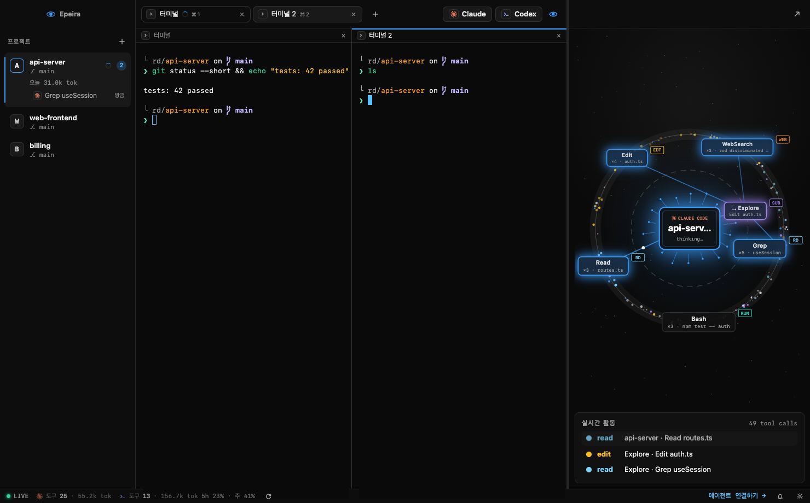

<p align="center">
  
</p>

# Epeira · Agent Orbit

프로젝트별 터미널과 Claude Code · Codex 세션을 한곳에서 다루고, 에이전트가 하는 일을 실시간 궤도로 보여 주는 macOS 데스크톱 앱입니다.



*가짜 세션 데이터로 찍은 화면입니다.*

- **프로젝트마다 따로인 터미널**: 프로젝트를 바꾸면 그 프로젝트의 탭만 보이고, 터미널을 멋대로 새로 열지 않습니다.
- **에이전트 궤도**: 가운데 HUB 는 지금 탭의 세션, 바깥 노드는 그 세션이 쓰는 도구입니다. 도구가 실행되면 HUB 의 가시가 노드까지 자랍니다.
- **화면 나누기**: 지금 칸을 좌우(`⌘D`) · 위아래(`⇧⌘D`)로 계속 나눠 한 프로젝트에 9칸까지.
- **지난 세션 · 이어 열기**: 프로젝트 아래에 최근 7일 세션(첫 질문이 제목)과 오늘 쓴 토큰. 누르면 그 대화를 새 탭에서 이어서 엽니다.
- **알림**: 응답을 마쳤거나 승인 · 입력을 기다리면 macOS 알림 · Dock 배지 · 탭 표시. 놓친 알림은 상태바의 종 아이콘에 모입니다.
- **명령 팔레트(`⌘P`)**: 명령 · 프로젝트 · 탭 · 지난 세션, 그리고 지난 7일의 질문 · 명령 기록까지 찾아 바로 이동합니다.
- **상태바**: 에이전트별 오늘 도구 호출 · 토큰, Claude · Codex 의 5시간 · 주간 사용 한도(마우스를 올리면 자세히).
- **다시 켜면 그대로**: 창 크기, 프로젝트별 탭 · 칸 배치를 복원하고, 대화는 그 탭을 처음 볼 때 이어서 엽니다.

## 설치 전 확인

| 필요한 것 | 설명 |
| --- | --- |
| macOS 13 이상 | Apple Silicon 용(`Epeira-<버전>-arm64.dmg`)과 Intel 용(`Epeira-<버전>.dmg`) 설치 파일. Intel 용은 아직 실제 Intel Mac 에서 시험하지 않았습니다 |
| Claude Code · Codex | 쓰려는 CLI 를 따로 설치하고 로그인 |
| Python 3.9 이상 | 궤도 · 사용량을 모으는 수집기용. macOS 개발자 도구(`xcode-select --install`)에 들어 있고, 없으면 앱이 설치 버튼을 보여 줍니다 |

DMG 에 Electron 이 들어 있어서 Node.js · npm 은 따로 필요 없습니다. AI 서비스 요금과 계정은 별도입니다.

## 설치

**[⬇ 최신 버전 받기 (GitHub Releases)](https://github.com/j-yesung/epeira/releases/latest)**

1. Releases 에서 내 Mac 에 맞는 DMG 를 받습니다. Apple Silicon(M1 이후)은 `Epeira-<버전>-arm64.dmg`, Intel 은 `Epeira-<버전>.dmg` 입니다. (Apple 메뉴 → 이 Mac에 관하여 → 칩)
2. DMG 를 열고 **Epeira 를 Applications 폴더로 끌어다 놓습니다.**
3. Finder 의 **응용 프로그램**에서 Epeira 를 실행합니다. DMG 안에서 바로 실행하지 마세요.
4. 앱이 켜지면 **수집기를 알아서 설치하고 실행합니다.** 터미널에 명령을 칠 필요가 없습니다.

### 첫 실행이 차단될 때

지금 배포본은 Apple Developer 인증서 서명 · 공증 없이 임시 서명(ad-hoc)으로 빌드합니다. 처음 실행할 때 개발자를 확인할 수 없다는 경고가 나오면:

1. Epeira 를 한 번 실행하고 경고를 닫습니다.
2. **시스템 설정 → 개인정보 보호 및 보안**의 아래쪽 **보안**에서 Epeira 의 **확인 없이 열기**를 누릅니다.
3. 암호 또는 Touch ID 로 인증하고 **열기**를 고릅니다.

회사 · 학교에서 관리하는 Mac 은 정책에 따라 막힐 수 있습니다. 자세한 내용은 [Apple 안내](https://support.apple.com/ko-kr/102445)를 참고하세요.

## 처음 쓰는 순서

1. 왼쪽 **+** 나 `⌘O` 로 프로젝트 폴더를 추가합니다. 폴더를 사이드바에 끌어다 놓아도 됩니다. 프로젝트에 마우스를 올리면 나오는 `⋯` 이나 오른쪽 클릭으로 새 세션 · Finder 에서 보기 · 경로 복사 · 목록에서 빼기를 고를 수 있습니다.
2. 처음 켜면 **설정**이 열립니다. Claude Code · Codex 의 **연결**을 누르면 바뀌는 설정 파일 내용을 먼저 보여 주고, 동의하면 연결합니다. Codex 는 훅 승인도 같은 화면에서 합니다.
3. Claude Code 의 **알림 켜기**를 누르면 권한 승인 · 입력을 기다릴 때도 알려 줍니다. (Codex 는 아직 이 신호를 보내지 않아 응답이 끝났을 때만 알립니다.)
4. 시작 화면이나 위쪽 버튼으로 Claude · Codex 새 세션을 엽니다. 도구를 쓰기 시작하면 오른쪽 궤도에 나타납니다.

Claude 의 사용 한도까지 보려면 **설정 → 에이전트 → Claude 사용 한도 보기**를 켭니다. 수집기가 Claude Code 로그인 정보로 Anthropic 에서 한도만 가져오며, 비용이나 한도 차감은 없습니다.

## 단축키

`⌘/` 로 앱 안에서도 볼 수 있습니다.

| 단축키 | 기능 |
| --- | --- |
| `⌘P` | 명령 팔레트 (프로젝트 · 탭 · 지난 세션 · 기록 찾기) |
| `⌘O` | 프로젝트 폴더 열기 |
| `⌘T` · `⇧⌘C` · `⇧⌘X` | 새 터미널 · Claude 새 세션 · Codex 새 세션 |
| `⌘W` | 탭 · 칸 닫기 (실행 중이면 먼저 물음) |
| `⌘1` ~ `⌘9` · `⌃⇥` | 지금 프로젝트의 탭 이동 |
| `⌘D` · `⇧⌘D` | 지금 칸을 좌우 · 위아래로 나누기 |
| `⌥⌘` + 방향키 | 칸 이동 |
| `⇧⌘↩` · `⌥⌘W` | 지금 칸 크게 보기 · 나누기 모두 풀기 |
| `⌘F` | 터미널에서 찾기 |
| `⌘⌫` | 터미널에서 지금 줄 지우기 |
| `⌘B` · `⌘J` | 사이드바 · 궤도 패널 보이기 / 숨기기 |
| `⌘,` | 설정 |

탭을 두 번 누르면 이름을 바꾸고(궤도 HUB 이름도 같이 바뀜), 끌어서 순서를 바꾸거나 다른 칸에 놓을 수 있습니다. 칸 경계선은 끌어서 크기를 바꾸고, 두 번 누르면 같은 크기로 맞춥니다.

## 데이터와 설정

수집기는 `127.0.0.1:47777` 에서만 열리고, 에이전트 활동 기록은 이 컴퓨터에만 7일 동안 보관합니다(질문 · 명령의 앞부분, 파일 이름, 토큰 수). 기록 폴더는 이 사용자만 읽을 수 있게 만들어 같은 Mac 의 다른 계정은 볼 수 없습니다.

- **앱 데이터**(프로젝트 목록 · 창 위치 · 테마): `~/Library/Application Support/Epeira/`
- **수집기 · 활동 기록**: `~/.agent-orbit`
- **연결할 때 바뀌는 설정**: Claude 의 `~/.claude/settings.json`, Codex 의 `~/.codex/hooks.json` 과 `~/.codex/config.toml` 승인 기록. 처음 원본은 `*.orbit-bak` 으로 남고, 연결을 해제하면 연결 전 파일 그대로 되돌립니다.
- **밖으로 나가는 요청**: Claude 사용 한도(켰을 때만, Anthropic 으로), Codex 사용 한도(Codex 자기 로그인으로 OpenAI 에), 새 버전 확인(6시간마다 사이트의 `app-version.json` 버전 번호만), 업데이트(누를 때만 GitHub Releases 에서 DMG 와 서명 파일).

## 업데이트와 삭제

새 버전이 있으면 상태바와 설정에 **새 버전**이 나옵니다. 앱은 6시간마다 확인하고, **설정 → 문제 해결 → 업데이트 확인**으로 바로 확인할 수도 있습니다. 누르면 Epeira 가 새 버전을 받아 관리자 서명을 확인하고, 다시 시작하면서 바꿉니다. 수집기도 앱에 든 버전으로 알아서 업데이트됩니다.

응용 프로그램 폴더에 쓸 권한이 없는 등 자동으로 바꾸지 못하면 내려받기 페이지나 DMG 를 열어 주니 직접 바꿔 주세요. 예전 이름(Tycho)으로 설치한 0.x 버전은 Epeira 1.0.0 을 한 번 직접 받아 주세요. 프로젝트 목록과 탭은 그대로 옮겨집니다.

앱만 지우려면 Applications 의 Epeira 를 휴지통으로 옮깁니다. 수집기는 별도 서비스라 남습니다. 수집기까지 지우려면:

```sh
~/.agent-orbit/bin/epeira uninstall
```

연결한 훅, 자동 실행, 수집기 파일, 활동 기록을 지웁니다. 설정 파일의 최초 백업(`*.orbit-bak`)과 앱 데이터 폴더는 남습니다.

문제가 있으면 **설정 → 문제 해결**에서 진단 정보를 복사하거나 수집기를 다시 설치할 수 있습니다.

## 참여 · 라이선스

버그 제보와 기여는 언제든 환영합니다. 개발 환경 · 테스트 · 릴리스 방법은 [CONTRIBUTING.md](CONTRIBUTING.md), 보안 문제는 공개 이슈 대신 [SECURITY.md](SECURITY.md) 의 방법으로 알려 주세요.

[MIT 라이선스](LICENSE) © Yesung Jang
