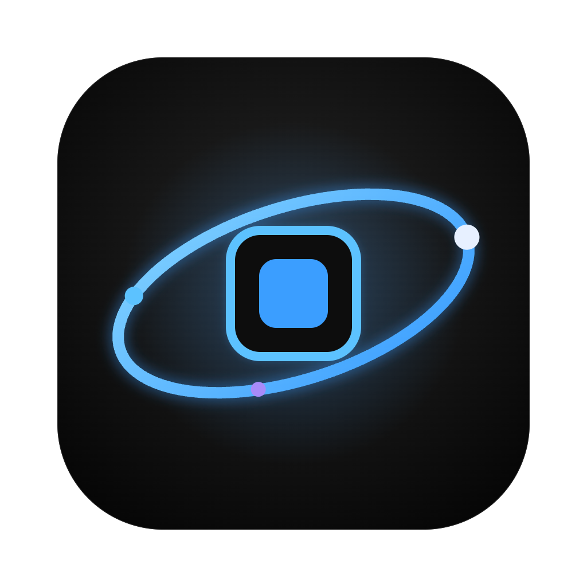
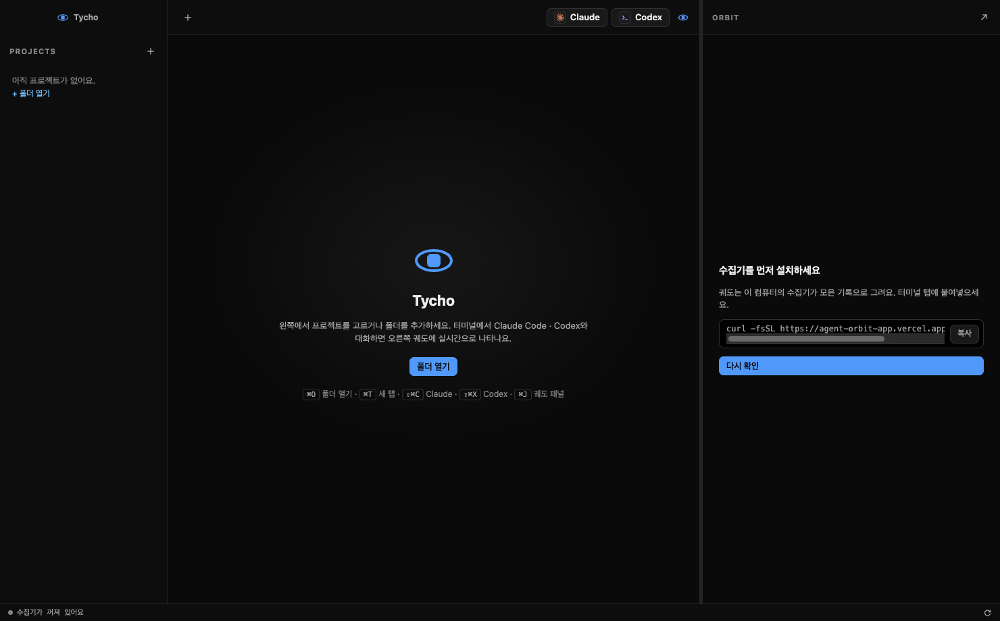

<p align="center">
  
</p>

# Tycho · Agent Orbit

프로젝트별 터미널과 Claude Code · Codex 세션을 한곳에서 다루고, 에이전트의 활동을 실시간 궤도로 확인하는 데스크톱 앱입니다.



*로컬 수집기를 연결하기 전의 실제 앱 화면입니다. 연결 후 오른쪽 패널에 에이전트 궤도가 표시됩니다.*

- **프로젝트 사이드바**: 작업 폴더를 추가하고 프로젝트 사이를 이동합니다. 목록에서 제거해도 실제 폴더는 삭제하지 않습니다.
- **터미널 탭**: 프로젝트 폴더에서 셸을 열고, Claude · Codex 버튼으로 새 세션을 시작합니다.
- **궤도 패널**: 로컬 수집기를 연결하면 현재 탭의 에이전트 활동을 보여줍니다.
- **사용량 상태바**: 오늘의 도구 호출·토큰 수와 기록된 Codex 사용 한도를 확인합니다.

## 설치 전 확인

현재 설치 파일은 **macOS 13 이상 · Apple Silicon Mac(M1 이후, arm64)** 용입니다. Apple 메뉴 → **이 Mac에 관하여**에서 macOS 버전과 칩을 확인하세요. Intel Mac·Windows용 설치 파일은 제공하지 않습니다.

| 사용하려는 기능 | 필요한 것 |
| --- | --- |
| 앱의 프로젝트 관리·일반 터미널 | Tycho DMG 설치 파일 |
| Claude Code · Codex 실행 | 사용하려는 CLI의 별도 설치 및 로그인 |
| 궤도·사용량 표시 | Python 3.9 이상과 로컬 수집기 설치·에이전트 연결 |

**DMG에는 Electron이 포함되어 있습니다.** 일반 사용자는 Electron·Node.js·npm을 따로 설치할 필요가 없습니다. AI 서비스 이용 요금과 계정은 별도입니다.

## 데스크톱 앱 설치

1. 배포자가 공유한 `Tycho-0.2.0-arm64.dmg`를 다운로드합니다. 공개 배포 파일은 [GitHub Releases](https://github.com/j-yesung/agent-orbit/releases)에서 확인할 수 있습니다. 파일이 없다면 아직 업로드되지 않은 상태이므로 배포자에게 DMG를 요청하세요.
2. DMG를 열고 **Tycho 아이콘을 Applications 폴더로 드래그**합니다.
3. 복사가 끝나면 Finder의 **응용 프로그램(Applications)** 에서 Tycho를 실행합니다. DMG 안에서 직접 실행하지 마세요.
4. 설치 디스크는 Finder에서 추출해도 됩니다.

### 첫 실행이 차단될 때

현재 배포본은 **Apple Developer 인증서 서명·공증 없이**, 임시 서명(ad-hoc)으로 빌드합니다. 처음 실행할 때 macOS가 개발자를 확인할 수 없다는 경고를 표시할 수 있습니다.

직접 받은 신뢰할 수 있는 배포 파일인지 확인한 다음 아래 순서로 허용하세요.

1. Applications의 Tycho를 한 번 실행하고, 차단 경고를 닫습니다.
2. **시스템 설정 → 개인정보 보호 및 보안**을 엽니다.
3. 아래쪽 **보안** 영역에서 Tycho에 대한 **확인 없이 열기(Open Anyway)** 를 누릅니다.
4. Mac 암호 또는 Touch ID로 인증하고 **열기**를 선택합니다.

한 번 허용하면 이후에는 일반 앱처럼 실행할 수 있습니다. 회사·학교에서 관리하는 Mac은 정책에 따라 허용이 제한될 수 있습니다. 자세한 내용은 [Apple의 앱 실행 안내](https://support.apple.com/ko-kr/102445)를 참고하세요.

## 처음 사용하는 순서

1. 왼쪽 **+** 또는 `⌘O`로 작업할 프로젝트 폴더를 추가합니다.
2. 프로젝트를 선택하면 해당 폴더에서 터미널이 열립니다.
3. **Claude** 또는 **Codex** 버튼을 눌러 설치된 CLI를 실행합니다. `command not found`가 나오면 해당 CLI 설치와 터미널의 PATH를 확인하세요.
4. 오른쪽 궤도·하단 사용량도 보려면 아래 수집기를 연결합니다. 수집기 없이도 프로젝트 관리와 터미널은 사용할 수 있습니다.

### 궤도·사용량을 위한 로컬 수집기 설치

앱 안의 터미널이나 macOS 터미널에서 Python 버전을 확인합니다.

```sh
python3 --version
```

Python 3.9 이상이 준비되면 아래 명령으로 수집기를 설치합니다. **이 명령은 DMG 설치와 별도이며, Electron을 설치하지 않습니다.**

```sh
curl -fsSL https://agent-orbit-app.vercel.app/install.sh | sh
```

수집기 파일은 `~/.agent-orbit`에 설치되고, 로그인 시 자동 실행이 등록됩니다. 설치가 끝나면:

1. 앱 오른쪽의 **다시 확인**을 누릅니다.
2. **보기 → 대시보드 크게 보기** 또는 [로컬 대시보드](http://127.0.0.1:47777/)를 엽니다.
3. 대시보드에서 Claude Code · Codex의 연결 안내를 따라 설정 변경 내용을 확인하고 적용합니다.
4. 에이전트 세션을 새로 시작합니다. Codex 훅 승인이 필요하다고 표시되면 Codex의 `/hooks`에서 확인합니다.

상태가 갱신되지 않으면 앱 하단 새로고침 버튼을 누르세요. 수집기 진단은 다음 명령으로 확인할 수 있습니다.

```sh
~/.agent-orbit/bin/tycho doctor
```

Python이 없다는 오류가 나면 Python 3.9 이상을 먼저 준비해야 합니다. macOS에서 설치 스크립트가 개발자 도구 설치를 안내한다면 `xcode-select --install`을 실행하고 완료 후 다시 시도하세요.

## 자주 쓰는 단축키

| 단축키 | 기능 |
| --- | --- |
| `⌘O` | 프로젝트 폴더 열기 |
| `⌘T` | 새 터미널 탭 |
| `⇧⌘C` | Claude 새 세션 |
| `⇧⌘X` | Codex 새 세션 |
| `⌘W` | 현재 탭 닫기 |
| `⌘1` ~ `⌘9` | 해당 터미널 탭으로 이동 |
| `⌃Tab` / `⌃⇧Tab` | 다음 / 이전 탭 |
| `⌘B` | 사이드바 표시·숨기기 |
| `⌘J` | 궤도 패널 표시·숨기기 |

탭이나 앱을 닫으면 그 안에서 실행 중인 터미널 프로세스도 종료됩니다. 진행 중인 작업을 확인한 뒤 닫으세요.

## 데이터와 설정

수집기는 `127.0.0.1:47777`에서 실행하며, 에이전트 활동 기록은 로컬에 저장합니다. 수집 기록에는 프롬프트·명령의 앞부분, 파일 이름, 토큰 수가 포함될 수 있으며 최근 7일 기록을 보관합니다. Claude·Codex 자체의 외부 통신은 각 서비스 정책을 따릅니다.

- **앱의 프로젝트 목록**: `~/Library/Application Support/Tycho/projects.json`
- **수집기·활동 기록**: `~/.agent-orbit`
- **에이전트 연결 시 변경되는 설정**: Claude의 `~/.claude/settings.json`, Codex의 `~/.codex/hooks.json` 및 `~/.codex/config.toml` 승인 기록. 기존 설정은 변경 내용을 확인한 뒤 연결하세요.

## 업데이트와 삭제

앱 업데이트는 Tycho를 종료한 뒤 새 DMG의 앱으로 Applications의 기존 앱을 교체합니다. 수집기 업데이트는 위 `curl` 설치 명령을 다시 실행합니다.

앱만 삭제하려면 Tycho를 종료하고 Applications의 Tycho를 휴지통으로 옮깁니다. **수집기는 별도 서비스이므로 앱을 삭제해도 남습니다.** 수집기도 삭제하려면 먼저 다음 명령을 실행하고 확인 질문에 답하세요.

```sh
~/.agent-orbit/bin/tycho uninstall
```

이 명령은 연결된 훅, 자동 실행, 수집기 파일과 활동 기록을 삭제합니다. 설정 파일의 최초 백업(`*.orbit-bak`)과 Electron 앱의 설정 폴더는 남습니다.

## 개발 및 설치 파일 만들기

소스에서 실행·빌드하는 개발자에게만 **Node.js 22.12 이상**, npm, macOS의 Xcode Command Line Tools가 필요합니다. `node-pty`를 Electron에 맞춰 컴파일하므로 빌드는 Apple Silicon Mac에서 진행하세요.

```sh
git clone https://github.com/j-yesung/agent-orbit.git
cd agent-orbit/desktop
npm ci
npm start
```

DMG 만들기:

```sh
npm run dist
```

결과는 `desktop/dist/Tycho-0.2.0-arm64.dmg`입니다. 현재 설정은 임시 서명만 적용하고 공증하지 않습니다. `node_modules`와 `dist`는 Git에서 제외되어 있습니다.

배포할 때는 생성된 DMG를 GitHub Releases의 첨부 파일로 올리고, 버전과 변경 내용을 함께 안내하세요. README를 저장하는 것만으로 설치 파일이 공개되지는 않습니다.
